# snow

**Video Assistant Referee (VAR) for Snowboarding**: 3D Biomechanics, Factored Trick Classification, and Official FIS Scoring from Monocular Broadcast Video.

Point it at a competition run — a YouTube broadcast, an Olympic slopestyle or big air run — and it automatically identifies usable slow-motion shots, tracks the athlete across cuts, extracts a 77-joint 3D metric skeleton for every frame, subtracts the broadcast camera's pan/tilt/zoom, and measures True Body Frame rotation: how far the rider turned, about which axis, angular velocity (RPM), and peak cork tilt.

Factored neural networks (**Models A, B, and C**) segment flight phases, decompose the aerial kinematics into official trick names (e.g. *Backside Double Cork 1080 Weddle*), and predict official FIS judging panel scores and landing probabilities trained on 5,000+ Olympic and World Cup jumps.

3D pose comes from the [NVIDIA 3D Body Pose NIM](https://build.nvidia.com/nvidia/body-pose), running on NVIDIA Cloud Endpoints or self-hosted GPU compute. **No wearable sensors, suit markers, or athlete setup required. No local GPU needed.**

---

## 34-Second End-to-End Walkthrough

<div align="center">
  <video src="docs/media/snow_demo_walkthrough_34s.mp4" controls="controls" width="100%" poster="docs/media/devpost_submission_screenshots/02_nvidia_nim_3d_pose_estimation.png">
    <a href="docs/media/snow_demo_walkthrough_34s.mp4">
      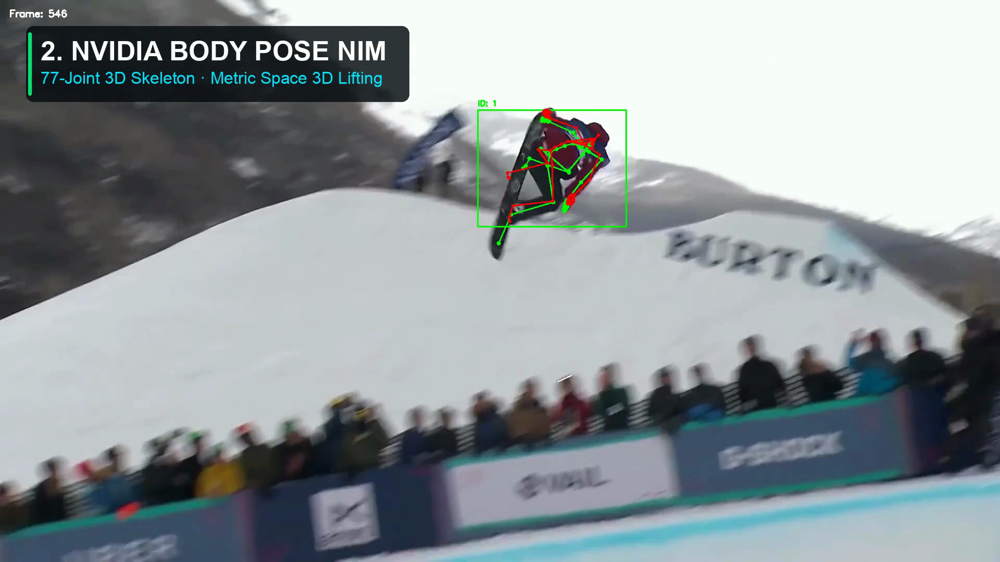
    </a>
  </video>
</div>

> [!TIP]
> **[▶ Watch the Full 34-Second Walkthrough Video (1080p MP4)](docs/media/snow_demo_walkthrough_34s.mp4)**:
> Ingest broadcast footage (Air 3 Double Cork 900) &rarr; 77-joint Nova skeleton extraction &rarr; 3D kinematics orbit (+977° spin, 112 RPM) &rarr; Omniverse USD digital twin split-screen &rarr; Factored AI trick classification &rarr; Interactive Snow VAR review dashboard.

---

## 77-Joint Skeleton & Biomechanics Showcase

### 1. 3D Skeleton Tracking in Real Time

<div align="center">
  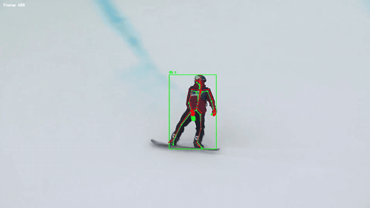
  <p><em>The 77-joint Nova skeleton lifted from monocular 2D broadcast video by the NVIDIA 3D Body Pose NIM, tracking kinematic continuity through an inverted double cork rotation.</em></p>
</div>

### 2. High-Resolution Skeleton & Telemetry Gallery

| 77-Joint Monocular 3D Pose | Mid-Air Aerial Inversion Pose |
|:---:|:---:|
| [](docs/media/devpost_submission_screenshots/02_nvidia_nim_3d_pose_estimation.png) | [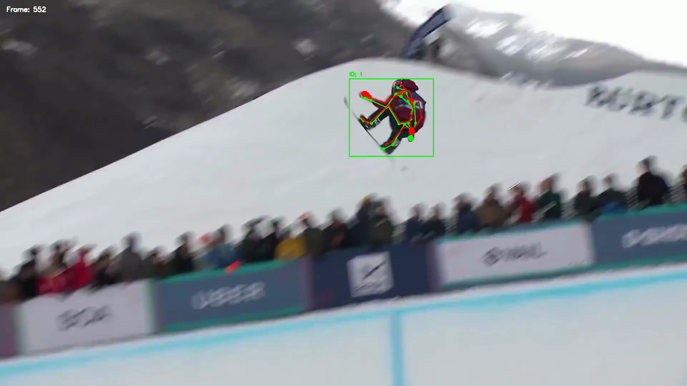](docs/media/devpost_submission_screenshots/10_nim_pose_midair_inversion.png) |
| **NVIDIA 3D Body Pose NIM**: Metric 3D lifting of all 77 kinematic joints directly from monocular 2D broadcast footage. | **Severe Inversion Tracking**: Maintains joint identity and limb position even when the rider is completely upside down. |

| Camera-Subtracted 3D Kinematics Orbit | Isaac Sim USD Digital Twin (Split-Screen) |
|:---:|:---:|
| [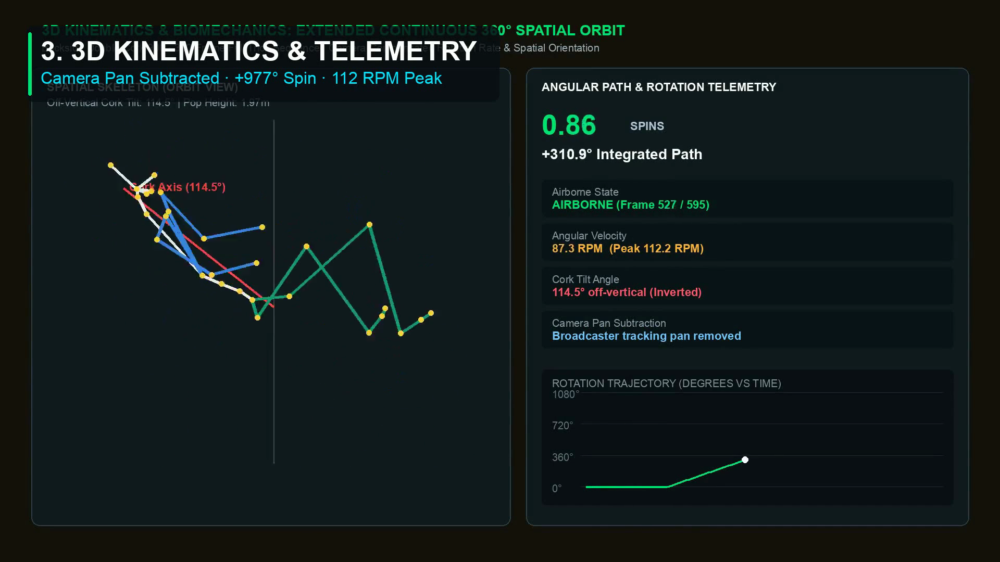](docs/media/devpost_submission_screenshots/03_camera_subtracted_3d_kinematics.png) | [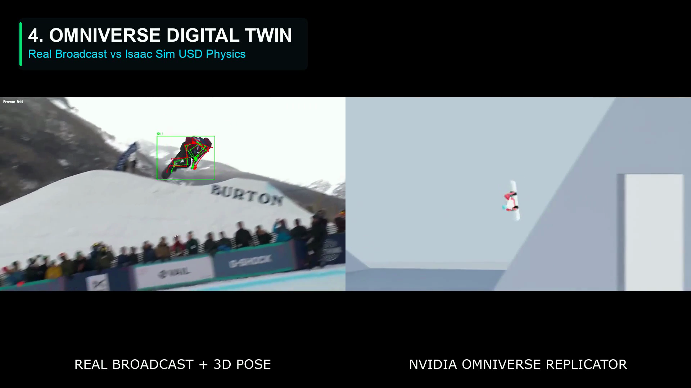](docs/media/devpost_submission_screenshots/04_omniverse_usd_digital_twin.png) |
| **Camera Pan Subtracted**: Continuous 360° orbit tracks +977° net rotation, 112 RPM peak spin rate, and 114.5° cork tilt. | **USD Digital Twin**: Real broadcast footage synchronized side-by-side with NVIDIA Isaac Sim USD physics simulation. |

| Factored Trick Classifier & FIS Scoring HUD | Interactive Snow VAR Review Dashboard |
|:---:|:---:|
| [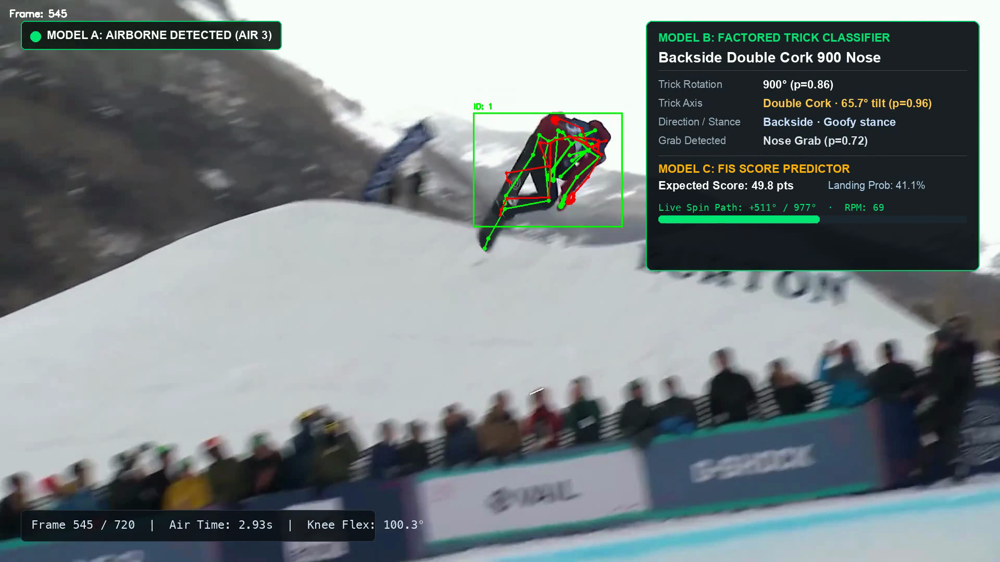](docs/media/devpost_submission_screenshots/13_live_hud_trick_classification.png) | [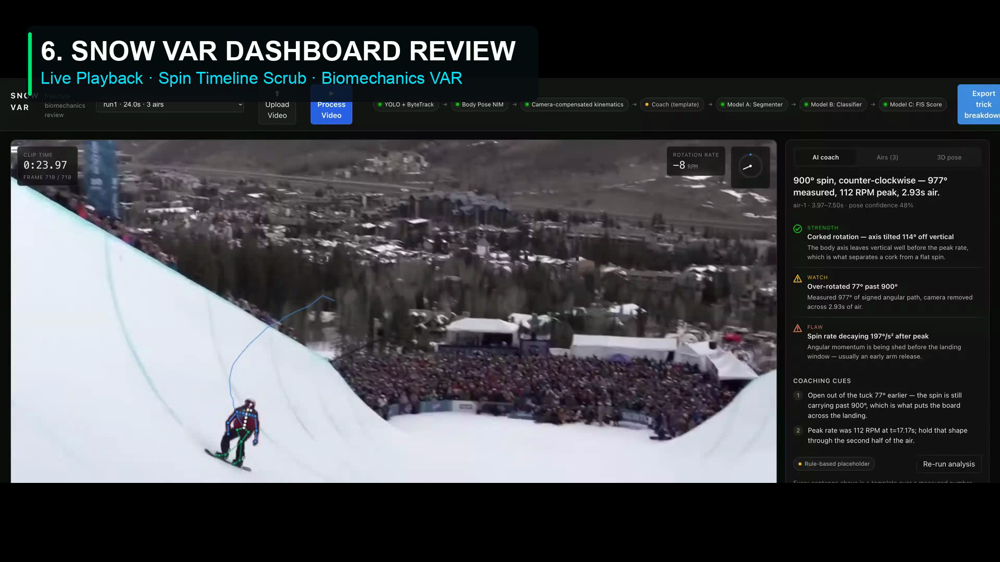](docs/media/devpost_submission_screenshots/06_snow_var_interactive_dashboard.png) |
| **Model B & C HUD**: Decomposes rotation, axis tilt, stance, and grab to classify trick and score 49.8 official FIS points. | **Interactive VAR Dashboard**: Synchronized dual-stream playback, interactive spin curve scrubbing, and biomechanics cues. |

| Multi-Angle 3D Pose Inspector | Biomechanics Landing Flexion Telemetry |
|:---:|:---:|
| [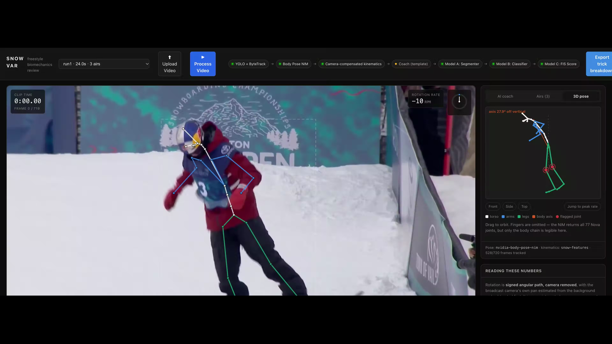](docs/media/devpost_submission_screenshots/14_3d_pose_inspector_multi_angle.png) | [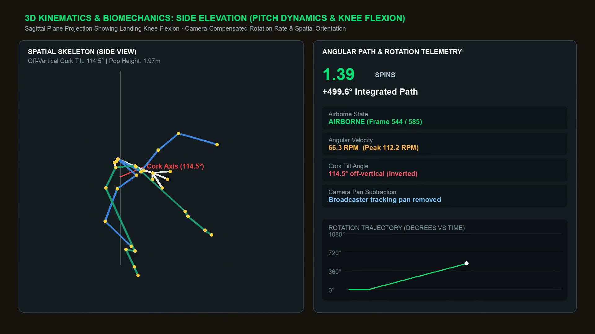](docs/media/devpost_submission_screenshots/12_biomechanics_landing_flexion_telemetry.png) |
| **Multi-Angle 3D Inspector**: Scrub frame-by-frame and examine 3D skeleton geometry from top, side, and elevation angles. | **Landing Telemetry**: Knee and hip flexion at snow contact (81.6° knee flexion) to measure landing stability. |

---

## How it works

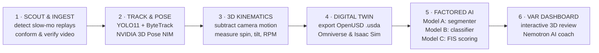

1. **Scout & Ingest**: Cuts broadcast slow-motion replays (`yt-dlp`, OpenCV, `ffmpeg`). Televised snowboarding mixes wide shots and crowd cutaways; Scout isolates and ranks high-speed replay shots. Ingest handles broadcast slow-motion conform timing and re-encodes to the NIM's exact format.
2. **Track & Pose**: Finds the rider with YOLO11 and ByteTrack, exports bounding boxes, and queries the NVIDIA 3D Body Pose NIM (gRPC endpoint). The NIM returns a metric 77-joint Nova skeleton for every frame.
3. **Camera Compensation & Kinematics**: Computes camera affine homography from background keypoints, subtracts camera rotation, and extracts True Body Frame spin (°), continuous axis tilt (°), and rotational velocity (RPM).
4. **USD Digital Twin**: Generates OpenUSD (`.usda`) scene descriptions without external dependencies. Opens in Omniverse, Isaac Sim, blender, or usdview for physics-based split-screen validation.
5. **Factored AI & Scoring**:
   - **Model A (Airborne Segmenter)**: Temporal 1D CNN separating in-run, takeoff, flight, and landing contact.
   - **Model B (Factored Trick Classifier)**: 5-head neural network decomposing rotation, spin sense, stance, axis, and grab into official trick names.
   - **Model C (FIS Big Air Score Regressor)**: Predicts landing probability and official 0–100 judging score, trained on 4,995 FIS World Cup & Olympic jumps.
6. **Snow VAR Dashboard & AI Coach**: React 18 + Vite web dashboard featuring synchronized video playback, interactive spin curve scrubbing, multi-angle 3D Pose Inspector, and an AI Coach powered by NVIDIA Nemotron.

---

## Architecture

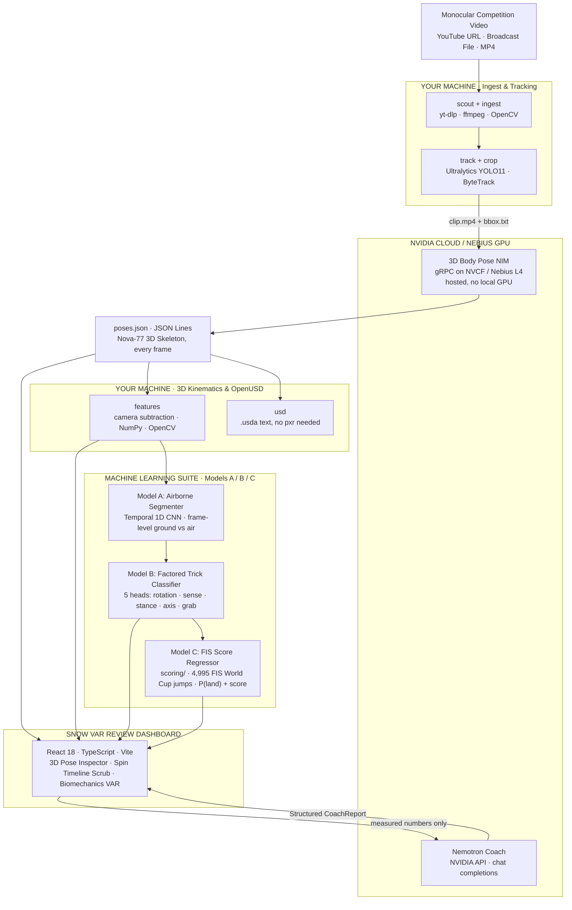

---

## Machine Learning Architecture (Models A, B, C)

```
                       ┌─────────────────────────────────────────────────────────┐
                       │                   77-Joint 3D Poses                     │
                       └────────────────────────────┬────────────────────────────┘
                                                    │
                                                    ▼
                       ┌─────────────────────────────────────────────────────────┐
                       │               Model A · Airborne Segmenter              │
                       │           Temporal 1D-CNN · Frame-Level Ground/Air      │
                       └────────────────────────────┬────────────────────────────┘
                                                    │
                                        airborne start / end frames
                                                    │
                                                    ▼
                       ┌─────────────────────────────────────────────────────────┐
                       │           Model B · Factored Trick Classifier           │
                       │           Shared Sequence Encoder + 5 Output Heads      │
                       └─────┬───────────┬─────────────┬───────────┬─────────────┘
                             │           │             │           │             │
                             ▼           ▼             ▼           ▼             ▼
                         Rotation      Sense        Stance       Axis          Grab
                         [0..1800°]   [CW/CCW]    [Reg/Goofy]  [Flat/Cork/DC] [7 types]
                             │           │             │           │             │
                             └───────────┴─────────────┼───────────┴─────────────┘
                                                       │
                                                       ▼
                                         Composed Official Trick Name
                                    "Backside Double Cork 1080 Weddle"
                                                       │
                                                       ▼
                       ┌─────────────────────────────────────────────────────────┐
                       │          Model C · FIS Competition Score Model          │
                       │    Gradient Boosted Trees trained on 4,995 FIS Jumps    │
                       └────────────────────────────┬────────────────────────────┘
                                                    │
                                   ┌────────────────┴────────────────┐
                                   ▼                                 ▼
                             P(Landing): 91.2%             Expected FIS Score: 49.8
```

### Model A · Airborne Segmenter
- **Purpose**: Distinguishes in-run approach, takeoff, airborne tricks, and landing contact.
- **Architecture**: Temporal 1D Convolutional Neural Network operating over smoothed 3D joint velocities and center-of-mass trajectory.
- **Execution**: Run `snow segmenter build`, `snow segmenter train`, and `snow features run1 --segmenter auto`.

### Model B · Factored Trick Classifier
- **Why Factored?** Independent prediction of rotation (0 to 1800° in 180° increments), spin sense (clockwise / counter-clockwise), stance (regular / goofy), axis (flat spin, single cork, double cork), and grab (indy, melon, mute, stalefish, tail, nose).
- **Advantage**: Eliminates combinatorial explosion across hundreds of trick variants; mirror augmentation preserves physical geometric consistency.
- **Execution**: Run `snow classify predict run1` or export to bundle with `python web/tools/export_session.py run1 --classify`.

### Model C · FIS Big Air Judging Score Model
- **Data**: Trained on official FIS results PDFs spanning 2019 to 2026 across 57 World Cup, World Championship, and Olympic contests (**4,995 jumps, 3,048 landed**).
- **Performance**: **7.8 MAE** on landed jumps, **0.68 within-contest Spearman rank correlation** against a human single-judge panel error ceiling of 1.95.
- **Features**: Dual-stage model: predicts landing probability $P(\text{land})$ and conditional panel score (0 to 100).
- **Execution**: Run via `scoring/predict.py b-DC-10-Wed --gender M --final`.

---

## Setup

```bash
# 1. Clone repository
git clone https://github.com/chostudio/snow.git
cd snow

# 2. Setup Python environment (requires Python 3.10–3.12 for NVIDIA client)
scripts/setup.sh
source .venv/bin/activate

# 3. Configure NVIDIA API credentials
cp .env.example .env
# Open .env and insert your API key from https://build.nvidia.com

# 4. Verify environment
snow doctor
```

`snow doctor` verifies your Python version, dependencies, FFmpeg installation, and NVIDIA API connection.

---

## Quickstart: Step-by-Step CLI Walkthrough

### 1. Ingest & Track Monocular Video

```bash
# Scout a competition video for usable slow-mo replays
snow scout "https://www.youtube.com/watch?v=..." --name olympics

# Ingest and re-encode chosen segment
snow ingest <url|file> run1 --start 00:00:34 --duration 24

# Track rider bounding box (with candidate previews)
snow track run1 --preview --show-candidates

# Stitch across camera cuts (manual merge avoids identity fusion)
snow track run1 --merge "1,8,945,1097,1738,1842" --preview
```

### 2. Extract 77-Joint 3D Poses & Kinematics

```bash
# Query NVIDIA 3D Body Pose NIM and generate skeleton overlay video
snow pose run1 --overlay

# Extract camera-subtracted 3D rotation, spin angles, and velocities
snow features run1

# Export 3D OpenUSD scene for Omniverse / Isaac Sim
snow usd run1
```

`--overlay` writes `data/poses/run1.overlay.mp4` with the 77-joint skeleton projected onto the original footage.

### 3. Classify Trick & Predict FIS Score

```bash
# Name aerial tricks using Model B
snow classify predict run1

# Predict official FIS score using Model C
cd scoring && uv run python predict.py b-DC-10-Wed --gender M --final
```

### 4. Launch Snow VAR Review Dashboard

```bash
# Export session bundle for web dashboard
python web/tools/export_session.py run1 --classify

# Start API server for live Nemotron coach
snow serve &

# Launch interactive React dashboard
cd web && npm ci && npm run dev
```

Open [http://localhost:5173](http://localhost:5173) in your browser.

---

## Deployment Options

### 1. NVIDIA Cloud Endpoints (Default)
- **Zero Local GPU Needed**: The 3D Body Pose NIM runs via hosted gRPC on NVIDIA NVCF (`build.nvidia.com`).
- The AI Coach runs via NVIDIA Nemotron Chat API.
- All local processing (tracking, camera homography, rotation math, web dashboard) runs lightweight on CPU.

### 2. Nebius Cloud GPU Backend (`deploy/nebius/`)
- Automated GPU VM deployment (NVIDIA L4 / H100) on Nebius Compute with S3-compatible object storage.
- Runs self-hosted containerized NIM, Model A/B training, and high-throughput batch extraction.
- See [deploy/nebius/README.md](deploy/nebius/README.md).

### 3. AWS Hosted Deployment
- Production AWS deployment configuration preserved on the `aws-deployment` branch (`tag: aws-hosted-release`).

---

## Truth in Numbers & Validation

Read [docs/validation.md](docs/validation.md) for full benchmarks. Key takeaways:

- **Exact Synthetic Math**: On synthetic motion renders (Isaac Sim), rotation mathematics is exact within **2°** (e.g. a known 1080° spin returns 1080° &plusmn; 2°).
- **Held-Out Synthetic Evaluation**: Tested across 96 held-out synthetic clips: the classifier names **96/96** tricks correctly with exact poses, and **67/96** when piped through the full noisy monocular pose pipeline.
- **FIS Score Prediction**: 7.8 MAE on landed jumps across 57 World Cup and Olympic contests, capturing ~40% of score variance from trick difficulty alone.
- **Camera Cut Recovery**: Broadcast cuts break tracker continuity. Snow provides interactive candidate ID inspection (`--show-candidates`) and manual track stitching (`--merge`) to guarantee correct athlete identity across cuts.
- **Metric Scale Note**: Without multi-camera metric calibration, absolute heights and scale are normalized. Angles, rotations, tilt ratios, and angular velocities hold true.

---

## Documentation Sitemap

| Deep Dive | Description |
|---|---|
| [docs/classifier.md](docs/classifier.md) | **Model B**: Factored 5-head neural network trick classification |
| [docs/segmenter.md](docs/segmenter.md) | **Model A**: Airborne temporal CNN segmentation |
| [scoring/README.md](scoring/README.md) | **Model C**: FIS Big Air competition score regression |
| [docs/footage.md](docs/footage.md) | Broadcast footage scout, slow-motion conform timing, encoding |
| [docs/tracking.md](docs/tracking.md) | YOLO11 + ByteTrack bbox format, candidate stitching |
| [docs/nim.md](docs/nim.md) | NVIDIA 3D Body Pose NIM endpoint, gRPC rules, self-hosting |
| [docs/rotation.md](docs/rotation.md) | Camera compensation, homography, True Body Frame rotation |
| [docs/usd.md](docs/usd.md) | OpenUSD `.usda` export, Omniverse Isaac Sim digital twin |
| [docs/coach.md](docs/coach.md) | NVIDIA Nemotron AI coach, prompt engineering, structured reports |
| [docs/labelling.md](docs/labelling.md) | `snow label` human annotation tool for real broadcast gold sets |
| [docs/synthetic.md](docs/synthetic.md) | NVIDIA Omniverse Replicator dataset generation in Isaac Sim |
| [docs/validation.md](docs/validation.md) | Comprehensive synthetic and real validation benchmarks |
| [deploy/nebius/README.md](deploy/nebius/README.md) | Nebius Cloud GPU VM setup and deployment |
| [web/README.md](web/README.md) | React review dashboard architecture and configuration |
| [AGENTS.md](AGENTS.md) | Technical architecture overview for AI agents working on Snow |

---

## Repository Layout

```
├── src/snow/               # Core pipeline: scout, ingest, track, pose, features, learn, serve
│   ├── learn/              # Model A (segmenter) and Model B (classifier) architectures
│   ├── label/              # Web-based real clip annotation tool (`snow label`)
│   └── cli.py              # Unified `snow` command line interface
├── scoring/                # Model C: FIS Big Air score regressor & landing classifier
│   ├── fis.py              # FIS official results crawler (2019-2026)
│   ├── parse.py            # PDF parser -> jumps.csv
│   ├── train.py            # Gradient boosted trees training & cross-validation
│   └── predict.py          # Trick scoring CLI
├── web/                    # Snow VAR Review Dashboard (React 18 + Vite + TypeScript)
│   ├── src/components/     # 3D Pose Inspector, Spin Scrubbing Timeline, AI Coach
│   └── tools/              # Session bundle exporter
├── docs/                   # 14 technical deep dives (footage, tracking, NIM, rotation, etc.)
│   └── media/              # 34s walkthrough video, animated skeleton GIF, and screenshots
├── deploy/                 # Cloud deployment configurations
│   └── nebius/             # Nebius Cloud GPU instance setup (startup.sh)
├── tests/                  # 191 unit tests (~45s execution, no network/GPU needed)
└── scripts/                # Environment setup, demo builders, and utilities
```

---

## License & Attribution

Built for the **NVIDIA Developer Contest**.
Pose estimation powered by the [NVIDIA 3D Body Pose NIM](https://build.nvidia.com/nvidia/body-pose).
Physics simulation powered by NVIDIA Isaac Sim & Omniverse Replicator.
AI Coach powered by NVIDIA Nemotron.
