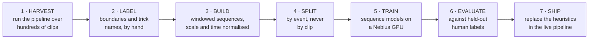
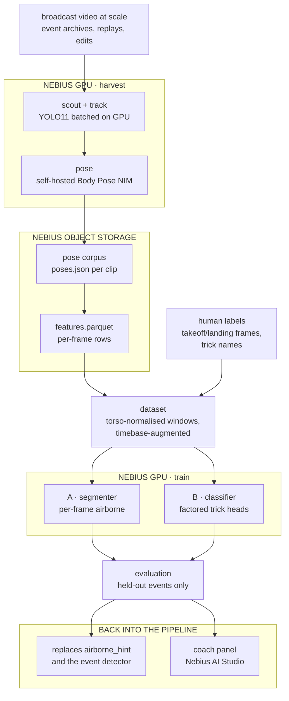

# Training the models

> **Status: planned, not built.** Nothing in this document exists in the repo
> yet. The pipeline today is entirely geometric: it *measures* rotation, it
> does not *classify* tricks. This is the design for the learned half, written
> to be reviewed before anything is implemented.

The companion to the two diagrams in the [README](../README.md): those show
how a clip is processed, this shows how the models in step 4 and step 6 would
come to exist.

## What is actually being learned

Two models, deliberately separate, because they need different label effort
and have very different payoffs.

**A. The segmenter** — per frame, is the rider airborne?

This replaces a placeholder. `features.py` currently ships `airborne_hint`,
which is `grab_distance < median(grab_distance)`: a within-clip median split,
so by construction about half of every clip is "airborne". The web app's event
detector is a separate heuristic again, hysteresis on rotation rate. Both work
well enough to demo and neither is defensible. Trick boundaries are the
foundation everything else sits on, so this model comes first.

**B. The classifier** — for one air, what trick was it?

Factored heads rather than one label: rotation amount, direction, axis/cork,
grab. See [why factored](#why-the-classifier-is-factored) below.

## Steps

1. **Harvest.** Run the existing pipeline at scale. This is the expensive step
   and the reason to rent a GPU at all: scouting and tracking are our compute,
   not NVIDIA's, and they are what currently limits us to one clip at a time.
2. **Label.** Humans mark takeoff and landing frames, and name the trick.
   Cheap for boundaries (roughly 100 airs an hour), expensive for names.
3. **Build.** Turn the pose corpus into fixed-shape tensors, normalised so the
   model cannot learn the camera or the broadcast's editing style.
4. **Split.** By source event, not by clip. This is the step most likely to be
   got wrong and the one that silently invalidates every number afterwards.
5. **Train.** Small sequence models; minutes, not days.
6. **Evaluate.** Against human labels only, never against the geometric
   measurement.
7. **Ship.** The segmenter replaces `airborne_hint` and the web event
   detector; the classifier feeds the dashboard and the coach panel.

## Architecture

Note that harvesting reuses the *existing* pipeline unchanged. No separate
training-time feature code: the model consumes exactly what `features.py`
writes at inference time, which removes the most common source of
train/serve skew before it can start.

## The decisions worth arguing about

### Labels come from humans, not from our own measurement

The tempting shortcut is to label tricks using `axis_spin_deg` — round to the
nearest 180 and call it a 720. Do not.

[validation.md](validation.md) is explicit that absolute spin counts are
unvalidated on real footage. A classifier trained on geometric labels learns
to reproduce an unvalidated measurement, and then its agreement with that
measurement gets reported as accuracy. That is laundering an open error into a
confident number, which is the exact failure this project is most exposed to.

Two consequences, and they point in opposite directions, so be deliberate:

- **Evaluation must use human labels only.** No exceptions.
- **Pre-training on geometric labels is fine**, as weak supervision, provided
  the held-out evaluation is human. Given how few labelled tricks a short
  project will produce, this is probably how you get enough signal.

There is a bonus here. Step 2 produces exactly the artefact the open
validation question needs: clips whose trick is known frame by frame. Labelling
a gold set is the same work as settling whether the pipeline's 668° reading on
a *"Frontside Double Cork 1080"* is a measurement error or the wrong shot. Do
that set first, before any model, and you get an answer either way.

### Split by event, not by clip

Broadcast footage shows the same trick several times: live, then a replay,
then a super-slow-motion replay from another angle. Those are different clips
of one event.

Split naively and the same trick lands in both train and test. The model
memorises it and the test score is meaningless, in the flattering direction.
Group by source event (ideally rider plus run plus hit), and hold out whole
events.

This is the single most likely way to get a great number that means nothing.

### Make the model invariant to the timebase, do not try to correct it

Conformed slow motion is 30 fps with a factor that cannot be recovered from
the file (invariant 8 in [AGENTS.md](../AGENTS.md)). `slowmo_factor` is 1.0
unless somebody knew it and typed it in, which for a harvested corpus means
almost never.

So resampling everything to "real time" is not available. The alternative is
better anyway: **random temporal resampling as augmentation**, so the model is
invariant to playback rate. Then

- rotation totals and angles carry the signal, which is correct, because they
  are the quantities slow motion does not corrupt;
- rates carry nothing, which is also correct, because on this corpus they are
  unknowable.

Trying to correct an unknown factor would bake a guess into the training set.
Training for invariance is the honest version of the same idea.

### Normalise by torso, not by metres

Metric scale is uncalibrated: the focal length is assumed, and skeletons come
out around 1.2 m tall. Absolute positions in metres are not a feature, they
are an artefact of that assumption.

Normalise joint positions by `torso_scale_m` (neck to root), which
`features.py` already computes and already uses to make `grab_distance`
scale-free. Angles, ratios and normalised distances are the trustworthy
quantities. Feed those.

### Mirroring flips the label

Horizontal mirror is the obvious augmentation and it is a trap: mirroring a
frontside rotation makes it backside, and regular stance switch. If you mirror
the pose without flipping the direction label, you teach the model that
direction does not matter, and direction is half the trick name.

Mirror freely, but flip the label with it.

### Never window across a camera cut

Same rule as the rest of the pipeline (invariant 6). `features.csv` carries a
`segment` column; windows must stay inside one. A window spanning a cut
contains a discontinuity that is pure editing, and the model will happily
learn it as a trick signature.

### Why the classifier is factored

The natural label, "frontside 1080 double cork melon", is combinatorial and
extremely long-tailed. As a single class you get one example of most labels.

Split into heads that each see the whole dataset:

| head | target | why it is learnable |
|---|---|---|
| rotation | multiple of 180° | ordinal, plenty of examples per bucket |
| direction | frontside / backside | binary, perfectly balanced with mirror augmentation |
| axis | flat / cork / double cork | correlates strongly with measured `tilt_deg` |
| grab | multi-label | independent of the rotation heads |

A composed trick name is then an assembly of head outputs, and a head can be
dropped if its data is too thin without taking the rest down with it.

## Models and cost

Both are small. The input is a few dozen channels at 30 fps over a few
seconds: a 2 GB GPU would do, and the Nebius rental is justified by the
harvest step, not by training.

- **Segmenter:** temporal CNN or BiGRU over roughly 2-second windows,
  per-frame binary output. Well under 1M parameters. Expect class imbalance,
  since airs are rare relative to approach and runout.
- **Classifier:** per-event, variable-length air resampled to a fixed number
  of frames, TCN or small transformer encoder with attention pooling, then the
  factored heads above.

The honest expectation for a short project: the segmenter is very likely to
work and to be a clear improvement on the heuristics. The classifier's
rotation and direction heads are plausible; cork and grab need more labelled
data than a hackathon produces.

## What would make this fail

Listed because each one produces a good-looking number rather than an error.

- Leakage across replays of the same event, giving an inflated test score.
- Evaluating against geometric labels, which measures self-consistency and
  reports it as accuracy.
- Training on uncorrected slow motion, so the model learns which broadcaster
  edited the clip.
- Mirroring without flipping direction, which quietly destroys the direction
  head.
- Too few labelled events, giving a classifier that has memorised a handful of
  riders.
