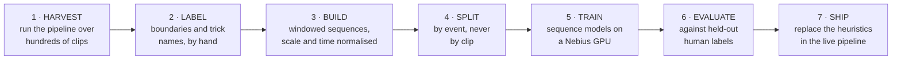
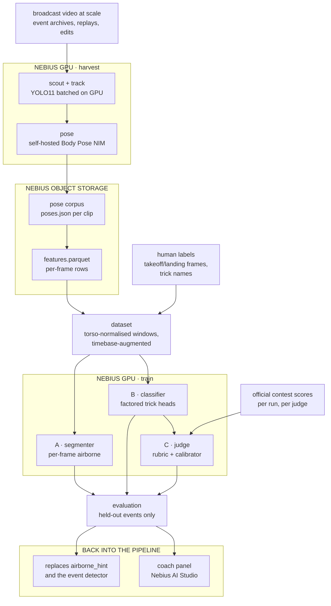
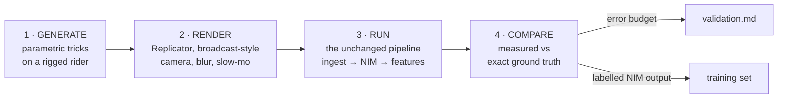

# Training the models

> **Status: planned, not built.** Nothing in this document exists in the repo
> yet. The pipeline today is entirely geometric: it *measures* rotation, it
> does not *classify* tricks. This is the design for the learned half, written
> to be reviewed before anything is implemented.

The companion to the two diagrams in the [README](../README.md): those show
how a clip is processed, this shows how the models in step 4 and step 6 would
come to exist.

## What is actually being learned

Two models, deliberately separate, because they need different label effort
and have very different payoffs.

**A. The segmenter** — per frame, is the rider airborne?

This replaces a placeholder. `features.py` currently ships `airborne_hint`,
which is `grab_distance < median(grab_distance)`: a within-clip median split,
so by construction about half of every clip is "airborne". The web app's event
detector is a separate heuristic again, hysteresis on rotation rate. Both work
well enough to demo and neither is defensible. Trick boundaries are the
foundation everything else sits on, so this model comes first.

**B. The classifier** — for one air, what trick was it?

Factored heads rather than one label: rotation amount, direction, axis/cork,
grab. See [why factored](#why-the-classifier-is-factored) below.

**C. The judge** — given the classified tricks and their measurements, what
would a judging panel score it? Sits at the end, on top of A and B. See
[the judging score](#the-judging-score) below.

## Steps

1. **Harvest.** Run the existing pipeline at scale. This is the expensive step
   and the reason to rent a GPU at all: scouting and tracking are our compute,
   not NVIDIA's, and they are what currently limits us to one clip at a time.
2. **Label.** Humans mark takeoff and landing frames, and name the trick.
   Cheap for boundaries (roughly 100 airs an hour), expensive for names.
3. **Build.** Turn the pose corpus into fixed-shape tensors, normalised so the
   model cannot learn the camera or the broadcast's editing style.
4. **Split.** By source event, not by clip. This is the step most likely to be
   got wrong and the one that silently invalidates every number afterwards.
5. **Train.** Small sequence models; minutes, not days.
6. **Evaluate.** Against human labels only, never against the geometric
   measurement.
7. **Ship.** The segmenter replaces `airborne_hint` and the web event
   detector; the classifier feeds the dashboard and the coach panel; the
   judge score, built last on both, adds an explained score estimate
   (see [the judging score](#the-judging-score)).

## Architecture

Note that harvesting reuses the *existing* pipeline unchanged. No separate
training-time feature code: the model consumes exactly what `features.py`
writes at inference time, which removes the most common source of
train/serve skew before it can start.

## The decisions worth arguing about

### Labels come from humans, not from our own measurement

The tempting shortcut is to label tricks using `axis_spin_deg` — round to the
nearest 180 and call it a 720. Do not.

[validation.md](validation.md) is explicit that absolute spin counts are
unvalidated on real footage. A classifier trained on geometric labels learns
to reproduce an unvalidated measurement, and then its agreement with that
measurement gets reported as accuracy. That is laundering an open error into a
confident number, which is the exact failure this project is most exposed to.

Two consequences, and they point in opposite directions, so be deliberate:

- **Evaluation must use human labels only.** No exceptions.
- **Pre-training on geometric labels is fine**, as weak supervision, provided
  the held-out evaluation is human. Given how few labelled tricks a short
  project will produce, this is probably how you get enough signal.

There is a bonus here. Step 2 produces exactly the artefact the open
validation question needs: clips whose trick is known frame by frame. Labelling
a gold set is the same work as settling whether the pipeline's 668° reading on
a *"Frontside Double Cork 1080"* is a measurement error or the wrong shot. Do
that set first, before any model, and you get an answer either way.

### Split by event, not by clip

Broadcast footage shows the same trick several times: live, then a replay,
then a super-slow-motion replay from another angle. Those are different clips
of one event.

Split naively and the same trick lands in both train and test. The model
memorises it and the test score is meaningless, in the flattering direction.
Group by source event (ideally rider plus run plus hit), and hold out whole
events.

This is the single most likely way to get a great number that means nothing.

### Make the model invariant to the timebase, do not try to correct it

Conformed slow motion is 30 fps with a factor that cannot be recovered from
the file (invariant 8 in [AGENTS.md](../AGENTS.md)). `slowmo_factor` is 1.0
unless somebody knew it and typed it in, which for a harvested corpus means
almost never.

So resampling everything to "real time" is not available. The alternative is
better anyway: **random temporal resampling as augmentation**, so the model is
invariant to playback rate. Then

- rotation totals and angles carry the signal, which is correct, because they
  are the quantities slow motion does not corrupt;
- rates carry nothing, which is also correct, because on this corpus they are
  unknowable.

Trying to correct an unknown factor would bake a guess into the training set.
Training for invariance is the honest version of the same idea.

### Normalise by torso, not by metres

Metric scale is uncalibrated: the focal length is assumed, and skeletons come
out around 1.2 m tall. Absolute positions in metres are not a feature, they
are an artefact of that assumption.

Normalise joint positions by `torso_scale_m` (neck to root), which
`features.py` already computes and already uses to make `grab_distance`
scale-free. Angles, ratios and normalised distances are the trustworthy
quantities. Feed those.

### Mirroring flips the label

Horizontal mirror is the obvious augmentation and it is a trap: mirroring a
frontside rotation makes it backside, and regular stance switch. If you mirror
the pose without flipping the direction label, you teach the model that
direction does not matter, and direction is half the trick name.

Mirror freely, but flip the label with it.

### Never window across a camera cut

Same rule as the rest of the pipeline (invariant 6). `features.csv` carries a
`segment` column; windows must stay inside one. A window spanning a cut
contains a discontinuity that is pure editing, and the model will happily
learn it as a trick signature.

### Why the classifier is factored

The natural label, "frontside 1080 double cork melon", is combinatorial and
extremely long-tailed. As a single class you get one example of most labels.

Split into heads that each see the whole dataset:

| head | target | why it is learnable |
|---|---|---|
| rotation | multiple of 180° | ordinal, plenty of examples per bucket |
| direction | frontside / backside | binary, perfectly balanced with mirror augmentation |
| axis | flat / cork / double cork | correlates strongly with measured `tilt_deg` |
| grab | multi-label | independent of the rotation heads |

A composed trick name is then an assembly of head outputs, and a head can be
dropped if its data is too thin without taking the rest down with it.

## Synthetic ground truth in Omniverse

> **Status: planned, not built.** Agreed direction for the next phase. It
> slots in *before* step 2 above, and changes what step 5 trains on.

### What Omniverse is for here, and what it is not

The tempting framing is "put the skeleton in Omniverse and classify tricks in
3D, because 3D is easier than video". The pipeline **already works in 3D**:
the NIM returns a 3D skeleton, `features.py` measures rotation from 3D joints
and quaternions, and the classifier above consumes 3D pose sequences, not
pixels. Loading the skeleton into Omniverse adds no information; it is a
viewer and a container.

The real bottleneck is the assumption hidden in that framing: *that the 3D
pose is accurate*. That is exactly what [validation.md](validation.md) says is
unproven (668° read on a clip titled as a 1080). Monocular pose is weakest
when a rider is inverted, blurred and twisting, and nothing done to the
skeleton afterwards can repair that.

So Omniverse's job is a **synthetic video generator with known answers**, not
a training environment. Training stays in PyTorch on joint sequences.

### The loop

1. **Generate.** A trick's ground truth is mostly the root rotating about a
   tilted axis, plus a body pose (tuck, grab). So tricks can be produced from
   parameters rather than hand-animated one by one: spin amount, direction,
   axis tilt (flat / cork / double cork), grab, takeoff and landing frames.
   Every combination comes with an exact label for free. Randomise pre-wind,
   tuck depth, grab timing and body shape so the model does not learn one
   animator's style. Blender (via the Blender MCP) can build the rig and
   generate the motion, exporting USD for Replicator.
2. **Render** with Omniverse Replicator to look like what the pipeline really
   sees: a camera that pans and zooms to follow the rider, motion blur,
   conformed slow motion at varied factors, snow, sky, halfpipe walls, crowd,
   and a spread of camera distances and angles. Record the camera's own
   trajectory too; it is ground truth for `camera.py`.
3. **Run the renders through the existing pipeline unchanged.** Same ingest,
   track, NIM and `features.py` as real footage. Do not shortcut by feeding
   the rig's skeleton straight to the model.
4. **Compare** measured against exact: spin, axis tilt, direction, camera
   rotation, airborne frames.

### Two payoffs

- **It settles the open validation question.** Render a known frontside
  double cork 1080 and see what `axis_spin_deg` reads. If it reads ~1080, the
  668° clip was probably the wrong shot; if it reads ~670, the measurement
  undercounts and the error is now reproducible and debuggable. Either way the
  result goes into [validation.md](validation.md) as a measured error budget,
  per axis tilt and camera angle.
- **Training data whose noise matches inference.** Labels are exact, and
  because they come from the scene, not from `axis_spin_deg`, this does not
  launder the measurement into its own labels (see above).

### Train on NIM output, never on the rig's clean skeleton

This is the most important rule in this section. A classifier trained on
clean animation skeletons never sees the NIM's real failure modes (hip axis
flipping when inverted, jitter, left/right swaps under blur) and will fall
over on real footage. Rendering → NIM → features gives the model the same
noise distribution it meets in production, and is the whole reason to render
video at all rather than export skeletons.

### What it does not replace

- **The real gold set.** Renders may be easier for the NIM than broadcast
  footage, which would make synthetic accuracy flattering. Final evaluation
  stays on hand-labelled *real* clips, held out by event. Synthetic data is
  for validation of the maths and for pre-training only.
- **Judgement about what needs learning.** If the synthetic loop shows
  `axis_spin_deg` and `tilt_deg` are accurate, rotation amount and axis are
  measurements (round to the nearest 180, threshold tilt), not learned heads.
  Spend the learning on the segmenter, grabs, and robustness to bad frames.

### Prerequisite: the USD export is still in the camera frame

`src/snow/usd.py` converts the NIM's camera axes to Y-up and nothing else. It
does **not** subtract the camera rotation that `features.py` estimates, so in
Omniverse the rider turns with the broadcast camera's pan, which is the same
error that moved a measured axis from 67° to 33° once corrected. Before USD
is used as a world-frame reference (for overlaying a reconstruction against
its synthetic ground truth, say), apply the inverse camera rotation from
`data/poses/<name>.camera.npz` to the root, per segment, never across a cut
(invariant 6). See [usd.md](usd.md).

### Existing data

As of October 2026, no public 3D motion-capture dataset of snowboard tricks
was found, which is why the tricks are generated. Leads worth knowing:

- [Comparative analysis of IMUs and markerless video motion capture in snowboard freestyle](https://www.researchgate.net/publication/390411706_Comparative_analysis_of_inertial_measurement_units_and_markerless_video_motion_capture_systems_for_assessing_rotational_parameters_in_snowboard_freestyle):
  88 tricks by 8 elite riders on a trampoline bounce board, multi-camera
  markerless capture. Lists a figshare dataset; contents and labels
  unconfirmed. Worth contacting the authors.
- [Wearable trick classification in freestyle snowboarding](https://ieeexplore.ieee.org/document/7516238/):
  275 tricks from IMUs, not pose. Shows classifying trick families works.
- FS-Jump3D (figure skating, cited by [VIFSS](https://arxiv.org/pdf/2508.10281)):
  253 jumps with 3D pose from 12 views. The closest analogue (rotational
  jumps); a structural template and a possible pre-training source.
- [BEDLAM](https://openaccess.thecvf.com/content/CVPR2023/html/Black_BEDLAM_A_Synthetic_Dataset_of_Bodies_Exhibiting_Detailed_Lifelike_Animated_CVPR_2023_paper.html)
  and [SURREACT](https://arxiv.org/pdf/1912.04070): precedent that training
  only on synthetic renders can transfer to real footage. No snowboarding.

### Order of work

1. Remove the camera rotation from the USD export (prerequisite above).
2. Generate and render about 20 parametric tricks covering flat, cork and
   double cork at 360 to 1440; run them through the pipeline; publish the
   error table in [validation.md](validation.md).
3. Let that table decide which heads need learning and which are
   measurements.
4. Scale the synthetic set, pre-train the segmenter and classifier on its NIM
   output, then fine-tune and evaluate on the real, human-labelled gold set.

## The judging score

> **Status: planned, not built.** Model C. Depends on A (where the airs are)
> and B (what they were), so it is built last.

### Two layers, so the number can always be explained

**Layer 1: a transparent rubric.** No training. Each trick gets component
scores that mirror how freestyle contests are judged (difficulty, execution,
amplitude, landing; halfpipe adds variety across the run), each computed from
signals the pipeline already has or will have:

| component | from | trust |
|---|---|---|
| difficulty | B's heads: rotation, axis, direction, switch, grab; a lookup table, harder = higher | as good as B |
| execution | grab held (fraction of the air with `grab_distance` under a torso-normalised threshold), body stability in the air, `confidence` dips | relative only |
| landing | post-landing jitter of root and torso, hand-to-snow contact, axis tilt at touchdown | relative only |
| amplitude | air duration in real time, peak height in torso lengths | **weak**; see below |
| variety (run) | distinct directions and axes across the run's tricks | as good as B |

The rubric is the explanation the dashboard shows. It is not claimed to
predict a real score.

**Layer 2: a calibrator learned from real judges.** Regress the official
score on layer 1's components. This is what turns "a rubric we invented" into
"a number that tracks what judges actually do".

### Labels: official contest scores

Judging scores for FIS, X Games and Olympic runs are public, per run and
often per judge. Pair each scored run with its broadcast footage and run that
footage through the pipeline. These are human labels, so they respect the
rule that evaluation never uses our own measurement.

**Start with big air.** One trick, one score, one clip: the cleanest pairing
there is. A halfpipe run is five or six hits and broadcasts rarely show all of
them in usable shots, so a run score cannot be explained by the hits we
actually measured. Add halfpipe only once missing hits can be handled
(score only fully covered runs, or treat coverage as a feature).

### Model

Hundreds of scored runs, not tens of thousands, so keep it small and
interpretable: ridge regression or gradient-boosted trees over layer 1's
components, never a deep net on raw pose. Feature importances then double as
a check that the model weighs difficulty and landing the way judging rules
say it should.

### The decisions worth arguing about

- **Judges score relative to the contest, not on an absolute scale.** The
  first rider anchors the panel and scores drift between events. Normalise
  within each contest (z-score, or train a pairwise ranking loss) and report
  ranking quality, not only absolute error.
- **The ceiling is judge disagreement.** Panels drop the highest and lowest
  of six scores precisely because judges disagree. Measure that spread on the
  same data; a model whose error is inside it is performing like an
  additional judge, and nothing better is achievable.
- **Split by contest**, never by run: riders, panels and conditions repeat
  within a contest. Same leakage logic as splitting by event above.
- **Amplitude is the weak component.** Metres are uncalibrated (invariant 7)
  and real air time needs `slowmo_factor` (invariant 8), which harvested
  footage rarely has. Use torso-normalised height and only compare amplitude
  within one contest's camera setup; if that is not enough, drop it rather
  than feed a guess.
- **Do not feed rider identity, nationality or result history.** Real scores
  carry reputation bias; a model given who the rider is will learn it.
- **Synthetic data cannot train this.** No judge watched the renders. The
  synthetic loop can only check that layer 1 behaves sensibly (a 1440 scores
  above a 1080, a clean landing above a hand drag).

### Evaluation

- Spearman rank correlation of predicted vs official ranking within each
  held-out contest: the headline, since a judge's real job is ordering.
- Mean absolute error on the 0 to 100 scale, set beside the judges' own
  spread on the same runs.
- Per component, how often layer 1 agrees with the judges' ordering, to show
  which signals carry weight.

### What it may not claim

It is an **estimate of what a panel would give**, never an official score,
and the dashboard must say so. Until B is validated on real footage, every
difficulty component inherits B's error; a wrong trick name gives a confident
wrong score, the exact failure this project is built to avoid.

## Models and cost

Both are small. The input is a few dozen channels at 30 fps over a few
seconds: a 2 GB GPU would do, and the Nebius rental is justified by the
harvest step, not by training.

- **Segmenter:** temporal CNN or BiGRU over roughly 2-second windows,
  per-frame binary output. Well under 1M parameters. Expect class imbalance,
  since airs are rare relative to approach and runout.
- **Classifier:** per-event, variable-length air resampled to a fixed number
  of frames, TCN or small transformer encoder with attention pooling, then the
  factored heads above.

The honest expectation for a short project: the segmenter is very likely to
work and to be a clear improvement on the heuristics. The classifier's
rotation and direction heads are plausible; cork and grab need more labelled
data than a hackathon produces.

## What would make this fail

Listed because each one produces a good-looking number rather than an error.

- Leakage across replays of the same event, giving an inflated test score.
- Evaluating against geometric labels, which measures self-consistency and
  reports it as accuracy.
- Training on uncorrected slow motion, so the model learns which broadcaster
  edited the clip.
- Mirroring without flipping direction, which quietly destroys the direction
  head.
- Too few labelled events, giving a classifier that has memorised a handful of
  riders.
- Training on the rig's clean synthetic skeleton instead of NIM output from
  rendered video, so the model never sees the pose errors real footage has.
- Reporting synthetic accuracy as real accuracy, when renders may be easier
  for the NIM than broadcast footage.
